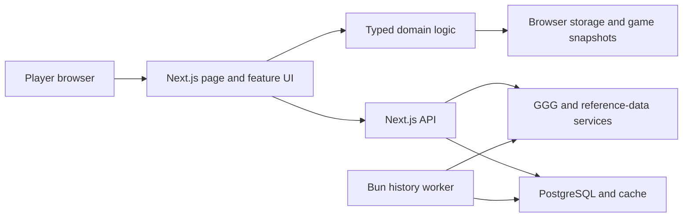
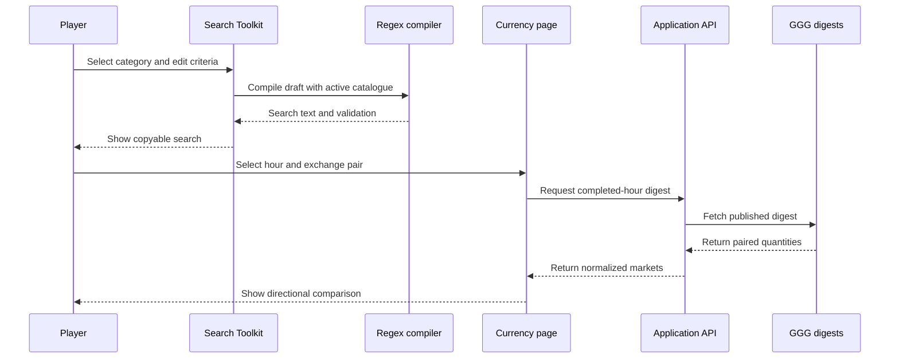

# Exile Atlas Architecture

## Architecture Analysis

### System Overview

One Next.js App Router application serves pages and a catch-all HTTP API. A separate Bun/BullMQ process collects optional hourly history. Browser storage supports local editing, React Query fetches remote data, and PostgreSQL stores server records when configured.

### Architectural Style

Modular web monolith with a separate scheduled collector. Feature UI lives in `src/components` and its domain logic in `src/lib`. GGG and community APIs, caching, authentication and durable storage sit behind `src/server`.

### Component Relationships

<!-- Text fallback: Feature pages use domain modules and browser storage. The API and background worker read external sources and use configured server storage. -->

### Data Flow

The Regex Toolkit compiles category drafts with a merged catalogue and checks pasted text locally. The Currency page loads the chosen completed-hour digest and optional history. Normalized records retain paired quantities for directional ratio calculation and history.

### Key Design Decisions

Local-first planning lets the core editors work without OAuth or a database. Public digests come through the web API, with an optional scheduled collector for additional history. These observed boundaries keep browser state distinct from account sessions and shared history.

### Improvement Opportunities

Keep recommendation definitions aligned with catalogue IDs and category constraints. Share any single-rate calculation across the Currency views with explicit direction and precision, while preserving the bounds consumed by crafting.

## Interaction Diagrams

<!-- Text fallback: Regex criteria are compiled locally with the active catalogue. Currency requests a completed digest through the application API and shows the selected pair in the browser. -->
